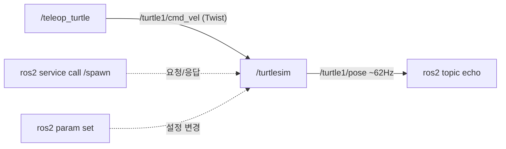
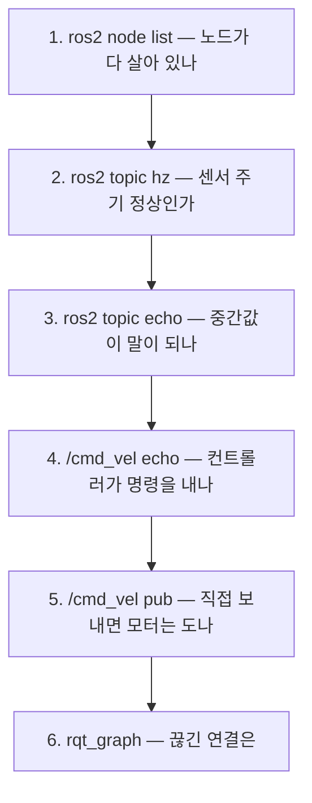
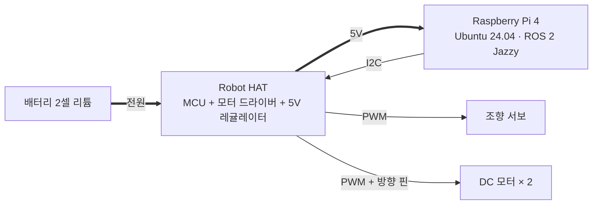

## 들어가며

이 글은 세 부분으로 나뉜다.

1. Raspberry Pi 4에 Ubuntu 24.04와 ROS 2 Jazzy를 올리고, SunFounder Robot HAT 라이브러리를 설치하면서 겪은 일
2. 그 전에 Mac에서 turtlesim으로 공부한 ROS 2 기초
3. PiCar-X를 이해하려고 정리한 하드웨어 기초(PWM, 모터 드라이버, 서보, I2C)

결론부터 적으면, **ROS 2 설치는 공식 문서대로 하면 됐고, 시간이 든 곳은 Robot HAT 라이브러리였다.** SunFounder 라이브러리는 Raspberry Pi OS를 전제로 만들어져 있어서 Ubuntu에서는 에러가 네 번 났다.

---

## 1. 우리 차와 환경

| 항목 | 값 |
|---|---|
| 차량 | SunFounder PiCar-X (Raspberry Pi 4 + Robot HAT) |
| OS | Ubuntu Server 24.04 (arm64) |
| ROS | ROS 2 Jazzy (`ros-base`) |
| 네트워크 | 아이폰 개인용 핫스팟 |
| 배터리 | 2셀 리튬, 측정값 7.7V (완충 8.4V) |

배포판은 팀 전원과 Pi 모두 **Ubuntu 24.04 + Jazzy**로 통일했다. 세미나 안내는 22.04 + Humble 기준이었지만, 개발 PC가 이미 Jazzy였고 배포판이 섞이면 통신 문제가 생길 수 있어서 하나로 맞췄다.

---

## 2. SSH 접속: `.local`이 안 되던 이유

Raspberry Pi Imager로 SD카드에 Ubuntu Server를 굽고, Wi-Fi와 계정, SSH를 미리 설정했다. 그런데 `ssh <계정>@<hostname>.local`을 치면 아무 출력 없이 멈췄다. 원인은 두 가지였다.

1. Pi가 아직 핫스팟에 붙지 않았다. 첫 부팅은 3~5분 걸린다.
2. **Ubuntu Server에는 mDNS(avahi)가 기본으로 없다.** 그래서 `.local` 이름으로 찾을 수가 없다.

결국 Mac에서 핫스팟 대역을 훑어 IP를 직접 찾았다.

```bash
# [Mac] 대역 전체에 ping → arp 표에서 SSH(22)가 열린 기기 찾기
for i in $(seq 2 14); do ping -c 1 -W 300 172.20.10.$i >/dev/null 2>&1 & done; wait
arp -a | grep 172.20.10
nc -w 3 <Pi IP> 22 </dev/null | head -1   # 배너에 'Ubuntu'가 보이면 Pi
```

- 아이폰 핫스팟은 **"호환성 최대화"** 를 켜야 Pi(2.4GHz)가 잘 붙는다.
- 다음부터는 Pi에 `avahi-daemon`을 설치하고, `ssh-copy-id`와 `~/.ssh/config` 별칭을 등록해 두면 편하다.

---

## 3. ROS 2 Jazzy 설치

[공식 문서](https://docs.ros.org/en/jazzy/Installation/Ubuntu-Install-Debs.html)를 따랐다. 24.04에서 걸린 곳은 한 군데였다. apt 소스의 `Suites`에 `noble-updates`, `noble-backports`가 없으면 `ros-dev-tools` 설치 때 의존성 충돌이 난다.

```bash
grep Suites /etc/apt/sources.list.d/ubuntu.sources
sudo sed -i 's/^Suites: noble$/Suites: noble noble-updates noble-backports/' /etc/apt/sources.list.d/ubuntu.sources
```

저장소 등록은 지금 문서 기준으로 `ros2-apt-source` .deb를 설치하는 방식이다. 그 뒤로는 패키지만 고르면 된다. Pi에는 화면이 없으니 `desktop`이 아니라 **`ros-base`** 를 깔았다.

```bash
sudo apt install -y ros-jazzy-ros-base ros-dev-tools \
                    ros-jazzy-cv-bridge ros-jazzy-image-transport python3-opencv
echo "source /opt/ros/jazzy/setup.bash" >> ~/.bashrc
echo "export ROS_DOMAIN_ID=<팀 번호>" >> ~/.bashrc
```

`ROS_DOMAIN_ID`는 같은 네트워크에서 다른 팀 로봇과 토픽이 섞이지 않게 나누는 번호다. Mac과 Pi가 같은 값이어야 서로 토픽이 보인다.

---

## 4. Robot HAT 라이브러리: 에러 4개

SunFounder 공식 설치 방법은 `install.py`를 돌리는 것이다. 하지만 이 스크립트는 Raspberry Pi OS 기준이라 Ubuntu에서는 쓰지 않고, `robot-hat`(2.5.x)과 `picar-x`(2.1.x)를 `pip`로 직접 설치했다. 그러자 에러가 차례로 났다.

| # | 에러 | 원인 | 해결 |
|---|---|---|---|
| ① | `ImportError: cannot import name 'Pin' from 'robot_hat'` (앞에 `missing python module(s): pyaudio, pygame` 경고) | robot-hat 2.5.x의 `__init__.py`는 `smbus2, lgpio, pyaudio, pygame` **4개가 모두 있어야** `Pin/ADC/Servo`를 불러온다. 소리를 안 써도 필요하다 | `python3-pyaudio`, `python3-pygame` 설치 |
| ② | `NameError: name 'error' is not defined` | MCU 리셋이 `pinctrl`/`raspi-gpio` **명령어**로 GPIO5를 토글한다. 둘 다 Raspberry Pi OS 전용이라 Ubuntu 저장소에 없다. 명령이 없을 때 부르는 에러 함수가 정의돼 있지 않은 라이브러리 버그 | `gpioset`으로 흉내 내는 `pinctrl` 대체 스크립트 작성 |
| ③ | `gpiodetect: unable to access GPIO chips: Permission denied` | `/dev/gpiochip*`에 일반 사용자 권한이 없다 | `gpio` 그룹 + udev 규칙, 재로그인 |
| ④ | `PermissionError: '/opt/picar-x'` | 보정값 파일 `/opt/picar-x/picar-x.conf`는 원래 `install.py`가 만든다. 건너뛰었으니 없다 | 폴더와 파일을 미리 만들고 내 계정 소유로 변경 |

②가 가장 오래 걸렸다. 처음에는 대체 스크립트를 libgpiod v2 문법(`-c`, `-t 0`)으로 썼는데 실패했다. Ubuntu 24.04의 gpiod는 **v1.6.3**이라 v1 문법을 써야 했다.

```sh
#!/bin/sh
# /usr/local/bin/pinctrl — robot-hat 호환용. "pinctrl set <핀> op dh|dl" 만 지원 (libgpiod v1)
[ "$1" = set ] && [ "$3" = op ] || { echo "pinctrl shim: unsupported: $*" >&2; exit 1; }
case "$4" in dh) v=1 ;; dl) v=0 ;; *) echo "pinctrl shim: bad value $4" >&2; exit 1 ;; esac
exec gpioset gpiochip0 "$2=$v"
```

`Picarx()`는 생성할 때 MCU 리셋을 부르기 때문에 이 스크립트가 없으면 차 객체 자체를 만들 수 없다.

그 밖에 알아 둘 것:

- `pip install`에 `--break-system-packages`를 붙여 **시스템 Python**에 설치했다. `ros2 run`으로 띄운 노드는 시스템 Python을 쓰므로 venv에 깔면 노드에서 `import picarx`가 안 된다.
- 테스트는 `cd ~`에서 한다. `~/picar-x` 폴더 안에서 실행하면 설치본이 아니라 소스 폴더를 import한다.

### 지금까지 확인한 것

- `import robot_hat, picarx` 성공
- `i2cdetect`에서 HAT MCU 주소 `0x14` 응답
- 대체 `pinctrl`로 MCU 리셋 통과
- 배터리 전압 7.7V, 초음파 거리, 회색조 센서 3채널 흑/백 구분

아직 확인하지 못한 것도 적어 둔다. `Picarx()`로 실제 전진 1초, `gpio` 그룹 적용 결과, `ros2 run demo_nodes_cpp talker`는 다음 글에서 다룬다.

### 라이브러리 소스를 읽고 알게 된 주의점

| 내용 | 영향 |
|---|---|
| `Picarx()`를 만드는 순간 서보 3개가 보정값 위치로 움직인다 | 실행 전에 손을 치운다. 배터리 없이 만들지 않는다 |
| 속도 변환이 `speed≠0`이면 `duty = speed/2 + 50` | speed 1도 50% 힘이다. 바닥에서는 10~20부터 |
| `forward()`가 오른쪽 모터에 음수를 준다 | 모터가 반대로 장착돼 있어서다. 단독 테스트에서 한쪽이 뒤로 도는 건 정상 |
| `Picarx()` 때마다 `sudo chmod/chown`을 몰래 실행한다 | 실행 중 `[sudo] password`가 뜰 수 있다. ROS 노드가 멈추는 원인 후보 |

### SD 이미지를 다시 구우면 다시 해야 하는 것

1. apt 추가 패키지 (`python3-pyaudio`, `python3-pygame`, `gpiod`, `avahi-daemon` 등)
2. `/etc/udev/rules.d/99-gpio.rules`와 `gpio` 그룹
3. `/usr/local/bin/pinctrl` 대체 스크립트
4. `/opt/picar-x/` 폴더 (캘리브레이션 **후에** 백업해야 보정값이 남는다)
5. `~/.bashrc`의 `source`와 `ROS_DOMAIN_ID`

---

## 5. ROS 2 기초: turtlesim으로 배운 것

Pi를 받기 전에는 Mac의 Docker(`tiryoh/ros2-desktop-vnc`)에서 turtlesim으로 연습했다. turtlesim은 `cmd_vel` 토픽에 `Twist`를 보내 움직이는 2D 거북이라서, 여기서 쓴 명령이 실차에 그대로 이어진다.

### 토픽, 서비스, 파라미터



- **토픽**은 계속 흘려보내는 방송, **서비스**는 요청 한 번에 응답 한 번이다. 노드끼리는 서로를 모르고, 토픽 이름과 타입만 같으면 연결된다.
- **`Twist`** 에서 2D 차량은 `linear.x`(전진, m/s)와 `angular.z`(회전, rad/s, +가 왼쪽)만 쓴다. `linear.x`는 화면의 x축이 아니라 **로봇 자신 기준** 전진이다.
- turtlesim은 명령이 1초쯤 끊기면 멈춘다. 통신이 끊겨도 폭주하지 않게 하는 안전장치이고, 실차도 같은 원리가 필요하다.

실차가 안 움직일 때 점검하는 순서도 이때 정리했다. 위에서부터 내려가다가 처음 이상한 단계가 문제 위치다.



### 첫 rclpy 노드: 목표점까지 가는 거북이

`/turtle1/pose`를 구독해서 목표까지의 거리와 방향을 계산하고 `/turtle1/cmd_vel`을 발행하는 노드를 만들었다. 노드의 뼈대는 네 가지다: **파라미터, 구독, 발행, 타이머.**

```python
self.declare_parameter("k_ang", 4.0)                                   # 파라미터
self.create_subscription(Pose, "/turtle1/pose", self.on_pose, 10)      # 구독
self.pub = self.create_publisher(Twist, "/turtle1/cmd_vel", 10)        # 발행
self.create_timer(0.05, self.control_loop)                             # 20Hz 타이머
```

제어 부분은 이렇다.

```python
heading_err = math.atan2(dy, dx) - self.pose.theta
heading_err = math.atan2(math.sin(heading_err), math.cos(heading_err))  # -π~π로 정규화
cmd.angular.z = k_ang * heading_err
cmd.linear.x = min(k_lin * dist, 2.0) * max(0.0, math.cos(heading_err))
```

- `atan(dy/dx)`가 아니라 `atan2`를 써야 사분면이 구분된다.
- 정규화를 빼면 +170°와 −170° 차이를 340°로 계산해서 쓸데없이 한 바퀴를 돈다.
- `max(0, cos err)`는 목표가 옆이나 뒤에 있을 때 전진을 멈추고 제자리 회전부터 하게 만든다.

### 콜백은 저장만, 계산은 타이머에서

구독 콜백에서 바로 계산하지 않고, 콜백은 최신값만 저장하고 타이머가 정해진 주기로 계산하게 나눴다. 이유는 셋이다.

1. 카메라(15Hz)와 LiDAR(10Hz)처럼 주기가 다른 센서를 합쳐야 한다.
2. PID의 D항과 I항은 `dt`를 쓰는데, 타이머를 쓰면 `dt`가 일정하다.
3. 센서가 끊겨도 루프가 돌기 때문에 "N초 동안 데이터가 없으면 정지" 같은 안전장치를 넣을 수 있다.

반대로 이미지 하나를 받아 차선 오차 하나를 내보내는 **변환 노드**는 콜백에서 바로 처리하는 게 자연스럽다.

### 게인을 키우면 왜 흔들리나

`ω = k·err`를 dt마다 적용하면 다음 오차는 `err[n+1] = (1 − k·dt)·err[n]`이다.

| k·dt | 결과 |
|---|---|
| 0 ~ 1 | 단조롭게 수렴 |
| 1 ~ 2 | 지나쳤다 돌아오며 진동하면서 수렴 |
| 2 이상 | 발산 |

dt=0.05에서 `k_ang`을 30으로 올리면 머리가 좌우로 떨리고, 50이면 뱅글뱅글 돈다. 실행 중에 `ros2 param set /turtle_goal k_ang 30.0`으로 직접 확인할 수 있다. "게인이 작으면 둔하고 크면 흔들린다"는 말의 수학적 이유가 이것이었다.

---

## 6. 하드웨어 기초: 명령이 바퀴까지 가는 길

소프트웨어만 해 봐서 PiCar-X를 뜯어보기 전에 기초부터 정리했다.

### 차 한 대의 구성



**Pi는 생각하고, HAT 위 MCU는 손발을 정확하게 움직인다.** 리눅스는 스케줄링 때문에 µs 단위 타이밍이 흔들리므로, 정확한 PWM 생성은 OS가 없는 MCU가 맡는다.

### PWM: 켜고 끄기만으로 중간값 만들기

디지털 핀은 0V 아니면 3.3V만 낸다. 그래서 아주 빠르게 켰다 껐다 하면서 **켜져 있는 시간**에 정보를 싣는다.

```
duty 25%: ▔|___▔|___▔|___   → 평균 약 0.8V처럼 작동
duty 75%: ▔▔▔|_▔▔▔|_▔▔▔|_   → 평균 약 2.5V처럼 작동
```

처음엔 주파수로 정보를 주는 줄 알았는데, 주파수는 보통 고정이다. 정보는 이름 그대로 **펄스 폭(Width)** 에 있다. 받는 쪽마다 해석이 다르다.

| | DC 모터 (뒷바퀴) | 서보 (조향) |
|---|---|---|
| 읽는 값 | duty 비율 → 속도 | 펄스 폭 절대값 → 각도 |
| 예시 | 50% → 절반 속도 | 1.5ms → 가운데, 1.0/2.0ms → 양 끝 |
| 주파수 | 수 kHz | 50Hz (20ms마다 1번) |

### 모터 드라이버는 전압을 줄이는 장치가 아니다

이것도 잘못 알고 있었다. Pi 핀은 3.3V, 수~십여 mA를 내는 **신호용**이고, 모터는 수백 mA 이상을 먹는다. 모터 드라이버는 Pi의 약한 신호대로 배터리의 큰 전력을 **대신 스위칭**해 준다. 내부의 H-bridge가 전류 방향을 뒤집어 전진/후진도 바꾼다. 배터리 전압을 Pi용 5V로 낮추는 건 별도의 **레귤레이터**가 한다.

그래서 "출발하자마자 Pi가 꺼진다"는 증상이 생기면 코드보다 배터리를 먼저 의심한다. 모터가 순간적으로 전류를 많이 먹어 5V까지 흔들리는 경우다.

### I2C: Pi가 HAT에게 일을 시키는 통로

SDA(데이터)와 SCL(클럭) 선 두 개를 여러 칩이 같이 쓰는 버스다. 칩마다 주소가 있어서 "0x14번 칩의 P2 채널 펄스를 1.2ms로" 하는 식으로 말한다. HTTP로 비유하면 주소는 호스트, 레지스터는 엔드포인트, 값은 요청 바디다.

```bash
i2cdetect -y 1
# 10: -- -- -- -- 14 -- ...   ← 14가 보이면 Robot HAT 응답
```

정리하면 제어 노드가 "왼쪽으로 꺾어"라고 정한 순간부터 서보가 움직일 때까지의 경로는 이렇다.


시뮬레이션에서는 오른쪽 하드웨어 부분을 시뮬레이터 노드가 흉내 내고, 실차에서는 motor 노드와 HAT이 그 자리를 맡는다. 토픽 이름만 맞추면 위쪽의 인지·제어 코드는 그대로 쓸 수 있다.

---

## 마치며

다음에 할 일:

- [ ] `Picarx()`로 전진 1초 (바퀴를 띄우고 → 바닥에서)
- [ ] 조향 +20°가 어느 쪽인지 기록해서 제어 코드 부호 기준 정하기
- [ ] 서보 중립 캘리브레이션
- [ ] `ros2 run demo_nodes_cpp talker` / `listener`로 Mac ↔ Pi 통신 확인
- [ ] 세팅이 끝나면 SD 이미지 백업
