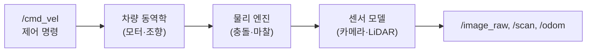
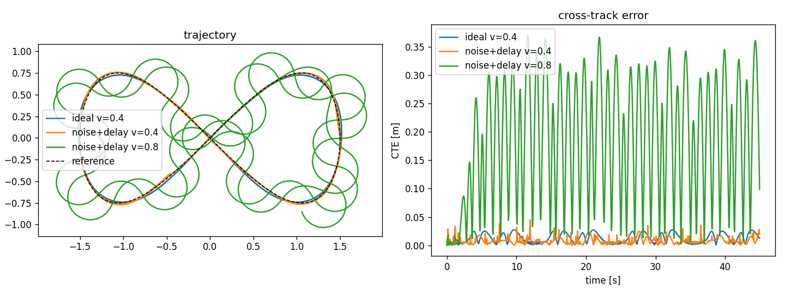
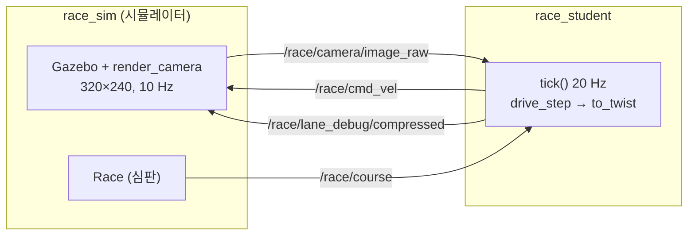
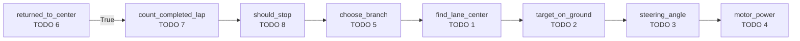
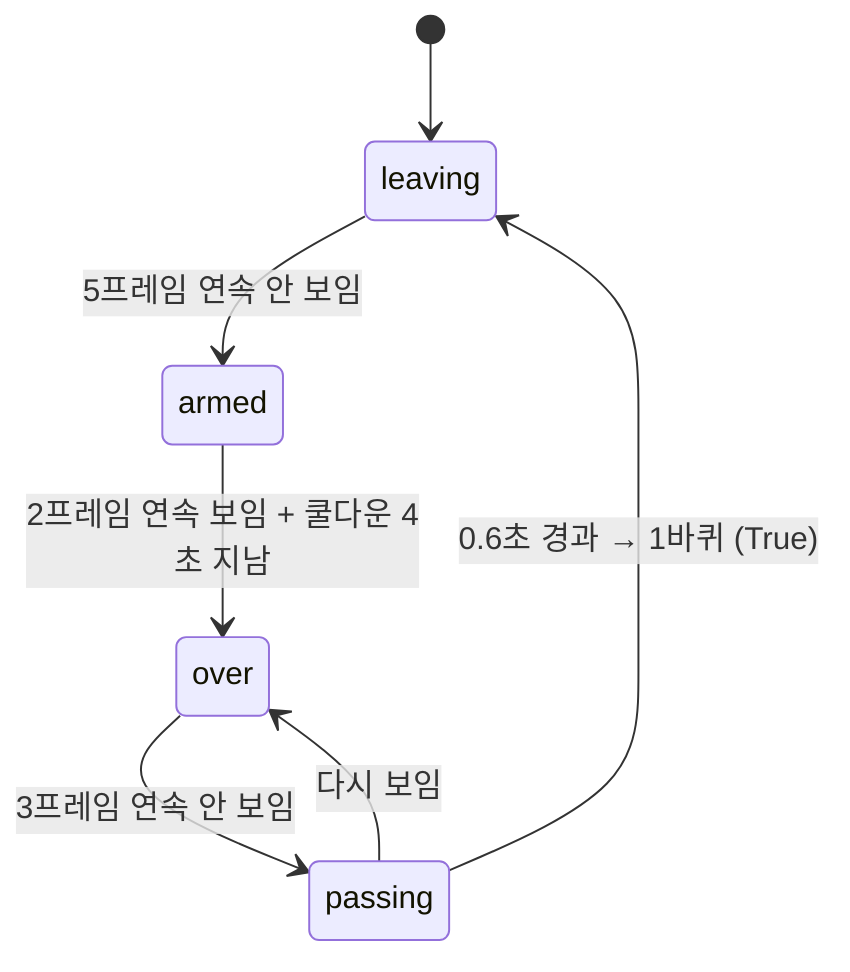
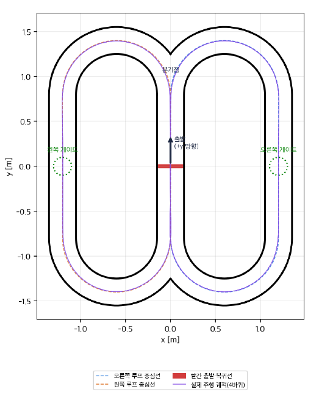
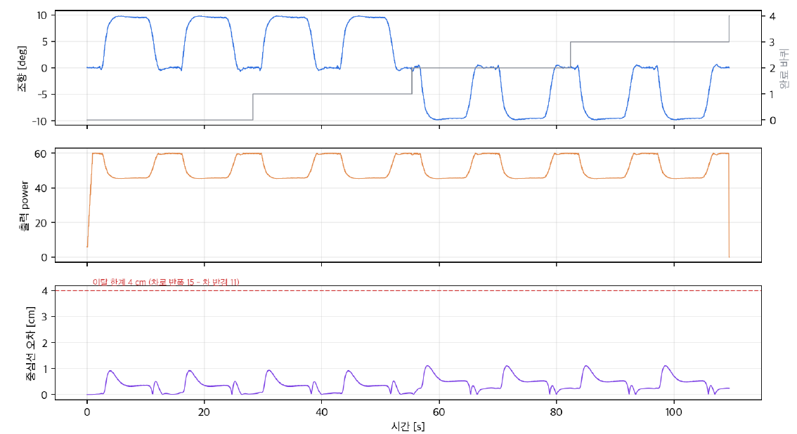

## 들어가며

[지난 글](/posts/picar-x-ros2-jazzy-setup/)에서 PiCar-X에 ROS 2 Jazzy를 올렸다. 이번 글은 그다음 단계인 시뮬레이션 이야기다.

1. 시뮬레이션을 왜 쓰는지, 시뮬레이터가 무엇으로 이루어져 있는지 공부한 내용
2. Python 50줄짜리 8자 주행 시뮬레이터로 지연과 속도의 관계를 직접 확인한 실험
3. 대회 Problem 1(8자 주행)의 `controller.py` TODO 8개를 채운 과정: 카메라 영상 → BEV → 차선 추적 → Pure Pursuit
4. 오프라인 시뮬레이션과 Gazebo에서 확인한 결과, 그리고 실차로 넘어갈 때 달라지는 것

결과부터 적으면, 제공된 카메라·심판 모듈로 만든 오프라인 시뮬레이션에서 **4바퀴를 108.6초에 완주했고 차선 이탈은 0회, 중심선 오차는 최대 1.11 cm**였다.

---

## 1. 시뮬레이션은 실차를 대체하지 않고 걸러 준다

실차로만 개발하면 배터리 충전, 코스 세팅, 수리에 시간이 들고, 조명과 배터리 전압이 매번 달라서 같은 상황을 다시 만들기 어렵다. 시뮬레이터는 같은 조건을 몇 번이든 다시 돌릴 수 있고, 차의 진짜 위치(ground truth)도 알고 있다.

그렇다고 시뮬레이션이 실차를 대신하지는 못한다.

```
아이디어 → [시뮬레이션에서 수백 번 실패] → 살아남은 것만 → [실차에서 몇 번 확인]
```

- 시뮬레이션에서 안 되는 건 실차에서도 거의 안 된다.
- 시뮬레이션에서 되는 건 실차에서 **될 수도 있다.**

그래서 "시뮬 통과 → 실차 검증 → 차이 분석 → 시뮬 보정"을 반복한다. 대회 최종 평가에 "시뮬레이션·실차 검증" 항목이 따로 있는 것도 이 과정을 보겠다는 뜻이다.

### 시뮬레이터의 구성

어떤 시뮬레이터든 아래 블록의 조합이다.



센서 모델은 시뮬레이터가 아는 "진짜 상태"를 실제 센서가 내놓을 법한 데이터로 바꾼다. 카메라라면 핀홀 모델로 3D 장면을 2D에 투영하고, 현실에 가깝게 하려면 노이즈·왜곡·조명 변화를 더한다.

### 시간: sim time과 wall time

| 용어 | 뜻 |
|---|---|
| Sim time | 시뮬레이터 안의 시계. ROS 2에서는 `/clock` 토픽으로 발행 |
| Wall time | 실제로 흐르는 시간 |
| RTF | sim time / wall time. 1.0이면 실시간, 0.5면 실제보다 2배 느림 |

ROS 2로 시뮬레이터를 쓸 때는 노드에 `use_sim_time:=true`를 줘야 한다. 빠뜨리면 노드는 벽시계를, 시뮬레이터는 sim time을 써서 TF 에러(`extrapolation into the future`)나 타이머 오작동이 난다.

---

## 2. 차량 모델: Kinematic Bicycle Model

네 바퀴 차를 앞바퀴 하나, 뒷바퀴 하나인 자전거로 단순화한다. 저속에서 바퀴가 미끄러지지 않는다고 가정하면 PiCar-X 같은 소형 차는 거의 이 모델로 설명된다.

상태는 위치 $(x, y)$, 방향 $\psi$, 속도 $v$이고 입력은 조향각 $\delta$다. $L$은 휠베이스다.

$$
\dot x = v\cos\psi,\qquad \dot y = v\sin\psi,\qquad \dot\psi = \frac{v}{L}\tan\delta
$$

핵심은 마지막 식이다. **같은 조향각이라도 빠를수록 빨리 돈다.** 회전 반경은 $R = L / \tan\delta$이고, 조향 한계가 정해져 있으니 최소 회전 반경도 정해진다. 코스의 가장 급한 커브가 이보다 커야 완주할 수 있다.

컴퓨터에서는 `dt`마다 상태를 갱신한다(오일러 적분).

```python
x   += v * cos(yaw) * dt
y   += v * sin(yaw) * dt
yaw += v / L * tan(steer) * dt
```

대회 시뮬레이터도 결국 같은 일을 한다. 제공된 `to_twist()`는 PiCar-X 단위(출력 power, 조향 각도)를 ROS `Twist`로 바꾸는데, 식이 그대로 이 모델이다.

```python
speed = car.power * car.profile.speed_per_power
yaw_rate = -speed * math.tan(math.radians(car.angle)) / car.profile.wheelbase
```

PiCar-X는 조향각이 +면 오른쪽이라 `yaw_rate` 앞에 마이너스가 붙는다.

---

## 3. 실험: Python 50줄로 만든 8자 주행 시뮬레이터

시뮬레이터가 마법이 아니라는 걸 확인하려고 직접 하나 만들었다. 매 스텝마다 **센서 → 인지 → 제어 → 지연 → 물리 → 평가**를 돈다.

```python
for k in range(int(T_END / DT)):
    # 1) 센서: 위치 측정 (노이즈 포함)
    mx = car.x + rng.normal(0, noise_std)
    my = car.y + rng.normal(0, noise_std)
    # 2) 경로에서 가장 가까운 점, 그리고 Ld만큼 앞의 목표점
    idx, _ = nearest_index(path, mx, my, idx)
    tj = target_index(path, idx, mx, my, LD)
    # 3) Pure Pursuit 조향 + P 속도 제어
    alpha = math.atan2(path[tj, 1] - my, path[tj, 0] - mx) - car.yaw
    steer_cmd = math.atan2(2 * L * math.sin(alpha), LD)
    accel = 2.0 * (v_ref - car.v)
    # 4) 액추에이터 지연 (서보는 즉시 안 움직인다)
    delay_buf.append(steer_cmd)
    steer = delay_buf.popleft()
    # 5) Kinematic Bicycle Model로 적분
    car.step(accel, steer, DT)
    # 6) 경로로부터의 횡방향 오차(CTE)
    _, cte = nearest_index(path, car.x, car.y, idx)
```

휠베이스 0.15 m, 전방 주시 거리 0.35 m, 스텝 50 ms로 돌린 결과다.

| 조건 | 평균 CTE | 최대 CTE |
|---|---|---|
| 노이즈·지연 없음, v=0.4 m/s | 1.3 cm | 2.8 cm |
| 위치 노이즈 2 cm + 조향 지연 0.3초, v=0.4 m/s | 0.8 cm | 4.5 cm |
| 위치 노이즈 2 cm + 조향 지연 0.3초, **v=0.8 m/s** | **18.4 cm** | **37.1 cm** |



여기서 확인한 것:

1. **저속에서는 지연이 크게 문제 되지 않았다.** 오히려 평균 오차가 줄었는데, 지연이 Pure Pursuit가 코너 안쪽을 파고드는 경향을 우연히 상쇄했기 때문이다. 좋아진 게 아니라 우연히 맞은 것이다.
2. **같은 지연에서 속도를 두 배로 올리니 평균 오차가 10배 넘게 커졌다.** 지연 동안 차가 움직이는 거리가 늘어나서다. "느리게는 되는데 빠르게 하면 튄다"의 정체가 대부분 이것이다.
3. **이상적인 시뮬레이터에서 튜닝하면 실차에서 망한다.** 지연과 노이즈를 넣고 튜닝해야 한다.
4. **8자 교차점 함정.** 경로 전체에서 가장 가까운 점을 찾으면 교차점에서 반대쪽 경로의 점을 잡아 엉뚱하게 꺾는다. 그래서 직전 인덱스 앞쪽 일부(window)만 탐색하게 했다.

---

## 4. 대회 Problem 1: 문제와 시스템

### 미션

카메라 한 대로 8자 코스의 차선을 따라 **오른쪽 루프 2바퀴, 왼쪽 루프 2바퀴**를 돈다. 심판은 차의 실제 위치로 채점한다.

- 분기점 근처의 좌·우 게이트를 지날 때 어느 쪽인지 기록한다. 한쪽을 세 번 쓰면 `branch_quota_violation`으로 실패한다.
- 빨간 출발선을 위쪽 방향(+y)으로 네 번 넘으면 `finished`.
- 차 반경 + 중심선 오차가 도로 반폭을 넘으면 `offroad`로 센다.

여기서 중요한 점이 하나 있다. **심판은 차의 위치를 알지만 우리 코드는 모른다.** 그래서 "몇 바퀴째인지"도 카메라로 빨간 선을 보고 스스로 세야 한다.

수정할 수 있는 파일은 `controller.py`, `figure_eight.json`, 새로 만드는 `student_*.py`뿐이다. 나머지는 운영진 제공 파일이라 `PROVIDED_FILES.sha256`으로 바뀌지 않았는지 검사한다. 시뮬레이션용과 실차용 `controller.py`는 같은 파일이어야 하고, 차이는 보정 파일(`figure_eight.json`)로만 둔다.

### 노드 구성



학생 코드는 `drive(car, observation)` 한 함수만 채우면 된다. `car.set_dir_servo_angle()`, `car.forward(power)`, `car.stop()`을 부르면, 매 틱 새로 만들어지는 버퍼에 담겼다가 시뮬레이터가 `Twist`로 바꾼다. 매 틱 새 버퍼를 쓰니 예외가 나거나 `forward()`를 빠뜨리면 차는 자동으로 멈춘다.

### TODO 8개가 불리는 순서



`drive()`는 같은 이미지가 다시 들어오면(`image_stamp`가 같으면) 계산하지 않고 직전 명령을 그대로 낸다. 카메라는 10 Hz인데 제어 틱은 20 Hz라서다.

---

## 5. 카메라 기하와 BEV

### 핀홀 카메라

제공된 합성 카메라(`render_camera`)는 바닥의 점을 이렇게 투영한다. $f$는 차 기준 앞쪽 거리, $l$은 왼쪽 거리다.

$$
u = 160 - \text{focal}\cdot\frac{l}{f},\qquad v = 65 + \text{focal}\cdot\frac{h}{f}
$$

멀어질수록($f$가 커질수록) 점이 화면 중앙 위쪽으로 모인다. 그래서 원본 영상에서는 평행한 두 차선이 八자로 보인다.

### 호모그래피로 BEV 만들기

원근을 없애고 위에서 내려다본 영상(Bird's Eye View)으로 바꾸려면 호모그래피를 쓴다.

$$
\begin{bmatrix}u'\\ v'\\ w\end{bmatrix} = H\begin{bmatrix}x\\ y\\ 1\end{bmatrix},\qquad u = u'/w,\; v = v'/w
$$

$H$는 미지수가 8개라 점 네 쌍이면 정해지고, `cv2.getPerspectiveTransform(src, dst)`가 이 계산을 해 준다. 원본 영상의 사다리꼴(`src`)을 BEV 영상 전체 직사각형(`dst`)에 대응시킨다.

```python
cx = 320 / 2                     # 160
top_y, bot_y = 0.3333 * 240, 0.5833 * 240   # 80, 140
top_hw, bot_hw = 0.1 * 320, 0.5 * 320       # 32, 160
src = [[cx - top_hw, top_y], [cx + top_hw, top_y],
       [cx + bot_hw, bot_y], [cx - bot_hw, bot_y]]
dst = [[0, 0], [320, 0], [320, 240], [0, 240]]
```

이 숫자들은 모두 `figure_eight.json`의 `lane.bev_*`에서 온다. 실차에서는 카메라 높이와 각도가 다르니 이 값을 다시 재야 한다.

### BEV 픽셀 ↔ 미터

BEV는 바닥을 균일하게 펼친 영상이라 픽셀과 미터가 1차식으로 이어진다. 위쪽(y=0)이 `far_m`=0.77 m, 아래쪽(y=240)이 `near_m`=0.154 m이고 좌우는 ±`half_width_m`(0.2347 m)이다.

$$
\text{forward} = 0.77 - \frac{y}{240}\times 0.616,\qquad \text{right} = \left(\frac{x}{320} - 0.5\right)\times 0.4693
$$

반대 방향(미터 → 픽셀)은 이 식을 거꾸로 풀면 된다. 예를 들어 차선 폭이 30 cm이니 오른쪽 경계는 중심에서 0.15 m에 있고, BEV에서는 $x = (0.15/0.4693 + 0.5)\times 320 \approx 262$ 근처에 보인다. 왼쪽 경계는 약 58이다.

---

## 6. TODO 구현

### TODO 1: 차선 경계 찾기

전체 흐름은 **이진화 → BEV → 시작점 히스토그램 → sliding window → 다항식 피팅 → 15 cm 안쪽 목표점**이다.

**① 이진화.** 회색조 대신 `image.max(axis=2)`(B, G, R 중 최댓값)를 밝기로 썼다. 회색조로 바꾸면 빨간 출발선(0,0,255)이 약 76이 돼서 검은 선 기준(`black_max`=130)보다 어두워진다. 최댓값을 쓰면 빨강은 255, 흰 바닥은 약 238, 검은 선은 약 18이라 검은 선만 남는다. BEV로 펼칠 때 바깥 영역은 `borderValue=255`(흰색)로 채워서 가짜 선이 생기지 않게 했다.

**② 시작점 히스토그램.** BEV 아래쪽 25%(차 앞 약 15~31 cm)에서 열마다 검은 픽셀 수를 더하고, 15 px 폭으로 이동 합(`np.convolve`)을 해서 선 하나가 한 봉우리로 보이게 만든다. 오른쪽 루프를 돌 때는 오른쪽 절반, 왼쪽은 왼쪽 절반에서만 찾는다.

여기서 그냥 `argmax`를 하면 분기점에서 다른 선에 붙는다. 그래서 **직전 프레임의 시작점(처음엔 이론값 262 또는 58) ±72 px**에서 먼저 찾고, 거기서 못 찾을 때만 반쪽 전체에서 찾게 했다. 3장의 8자 교차점 함정을 카메라 버전으로 푼 셈이다.

**③ sliding window.** BEV를 세로 12칸(칸당 20 px)으로 나누고, 아래에서 위로 올라가며 ±36 px 창 안의 검은 픽셀 평균 x로 다음 창 위치를 옮긴다. 창 안 픽셀이 12개 미만이거나, 0.5 m보다 멀어지거나, 화면 끝에 닿으면 멈춘다.

**④ 15 cm 안쪽 목표점.** 찾은 픽셀을 미터로 바꿔 경계선을 $r = g(f)$ 다항식으로 맞춘다(앞뒤로 15 cm 넘게 보이면 2차, 아니면 1차). lookahead 거리(0.2 m)에서 경계 위치 $r_b$와 기울기 $s = dr/df$를 구하고, 접선 $(1, s)$에 수직인 법선 방향으로 차선 반폭 0.15 m만큼 안쪽으로 들어간 점을 목표로 삼았다.

$$
n = \frac{(\text{sign}\cdot s,\; -\text{sign})}{\sqrt{1+s^2}},\qquad \text{target} = (0.2,\; r_b) + 0.15\,n
$$

`sign`은 오른쪽 경계면 +1, 왼쪽이면 -1이다. 직선($s=0$)이면 경계에서 옆으로 정확히 15 cm, 커브면 기울어진 만큼 앞뒤로도 보정된다.

**⑤ 잠깐 놓쳤을 때.** 경계를 못 찾으면 직전 목표점을 최대 5프레임까지 재사용하고, 그동안은 속도를 60%로 줄인다.

디버그 화면에는 원본에 BEV 사다리꼴을, BEV 마스크에 창·피팅 곡선·lookahead 선·목표점을 그려서 `/race/lane_debug`로 보냈다. 단계별로 문제가 어디서 생기는지 눈으로 확인할 수 있다.

### TODO 2: BEV 픽셀 → 차 기준 미터

5장의 식을 그대로 쓴다. 결과가 유한하지 않거나 앞쪽 거리가 0 이하면 `None`을 돌려 차를 세운다.

### TODO 3: Pure Pursuit 조향

목표점 $(f, r)$을 지나는 원을 그린다고 생각한다. 원의 중심이 차 옆 $(0, R)$에 있으면

$$
f^2 + (R - r)^2 = R^2 \;\Rightarrow\; R = \frac{l_d^2}{2r},\qquad \kappa = \frac{2r}{l_d^2}\quad (l_d^2 = f^2 + r^2)
$$

이고, 자전거 모델에서 $\tan\delta = L\kappa$이니 조향각은 $\delta = \arctan(L\kappa)$다.

```python
ld_sq = forward * forward + right * right
curvature = 2.0 * right / ld_sq
angle = math.degrees(math.atan(wheelbase * curvature))
return max(-25.0, min(25.0, angle))
```

휠베이스는 `car.profile.wheelbase`로 받기 때문에 실차로 가도 코드를 고칠 필요가 없다.

### TODO 4: 속도

조향이 클수록 줄인다.

```python
power = max(POWER_MIN, POWER_STRAIGHT - POWER_PER_DEG * abs(angle))   # 60, 35, 1.5
if self._lost_frames > 0:
    power *= POWER_LOST_SCALE                                         # 0.6
power = min(power, self._last_power + POWER_RAMP_UP)                  # 프레임당 +6
```

시뮬레이션에서 power 1당 0.005 m/s라 직선 60은 0.30 m/s다. 출발할 때 갑자기 가속하면 차선을 벗어나서 프레임당 증가량에 상한을 뒀다.

### TODO 5: 분기 선택

```python
return 'right' if lap_index < 2 else 'left'
```

0, 1바퀴째는 오른쪽, 2, 3바퀴째는 왼쪽이다. 같은 쪽을 연속으로 돌면 분기 전환이 한 번뿐이라 실수할 여지가 줄어든다.

### TODO 6: 빨간 출발선 통과 감지

카메라는 차 바로 앞의 선을 못 본다. 그래서 "선이 보였다가 화면 아래로 사라진 뒤 조금 더 가면 넘은 것"으로 판단했다. 원본 영상 아래 28%(차 앞 약 10 cm)만 HSV로 보고, Hue가 0~10 또는 170~179인 빨간 덩어리 중 가로 폭이 영상의 40% 이상이고 가운데에 있는 것만 출발선으로 인정한다. OpenCV의 Hue는 0~179라 빨강이 양 끝으로 갈라져 두 범위를 OR로 합친다.

노이즈 한 프레임에 속지 않도록 상태 기계로 만들었다.



출발할 때 차가 출발선 위에 있으니 시작 상태를 `leaving`으로 둬서 첫 프레임에 바퀴를 세지 않게 했다. 한 바퀴는 10초 이상 걸리니 4초 쿨다운으로 중복 계수도 막았다.

### TODO 7, 8: 바퀴 수와 정지

`returned_to_center()`가 True를 한 번 낼 때 완료 바퀴를 1 늘리고, `lap_count`(4)에 도달하면 정지한다. `drive()`는 바퀴가 바뀌면 `direction`을 비워서 다음 틱에 `choose_branch()`를 다시 부른다.

---

## 7. 결과

### 오프라인 시뮬레이션

Gazebo 없이 Mac에서 먼저 확인하려고, 제공된 `render_camera`(합성 카메라), `Race`(심판), `to_twist`, `limit_command`를 그대로 쓰고 위치만 자전거 모델로 적분하는 작은 시뮬레이터를 만들었다. 카메라는 2틱(0.1초)마다 한 장, 명령은 한 틱 늦게 적용해서 지연을 흉내 냈다.

```python
for k in range(int(300 / dt)):          # dt = 0.05
    if k % 2 == 0:
        image = render_camera(course, pose); stamp = t
    car = drive_step(ctrl, Observation(None, None, image, -1, settings, stamp), prof)
    pending.append(limit_command(Command(*to_twist(car)), course))
    if len(pending) > latency: cmd = pending.pop(0)
    # 위치 적분 후 심판에게 전달
    race.advance(dt, pose, cmd.speed)
```

| 항목 | 결과 |
|---|---|
| 심판 판정 | `finished`, 108.6초 (제한 300초) |
| 분기 순서 | right → right → left → left |
| 차선 이탈 | 0회 |
| 중심선 오차 | 최대 1.11 cm, 평균 0.38 cm (한계 4 cm) |
| 명령 지연 1~3틱(50~150 ms) | 모두 완주 |


_보라색 실제 궤적이 루프 중심선(점선)과 거의 겹친다._


_위부터 조향각과 완료 바퀴, 출력, 중심선 오차. 커브에서 조향 약 9.5°, 출력 약 46으로 일정하고 분기점과 합류점에서만 오차가 잠깐 커진다._

이 결과는 운동학 근사다. Gazebo에는 가감속 한계, 바퀴 미끄러짐, 실제 통신 지연이 있어서 시간과 오차가 조금 다를 수 있다.

### Gazebo 단계별 테스트

그래서 VM(Ubuntu 24.04 + Jazzy + Gazebo Harmonic)에서 다시 돌렸다.

```bash
source /opt/ros/jazzy/setup.bash
bash tools/run.sh build                   # 처음 한 번 (symlink 설치라 이후 .py 수정은 재실행만)
bash tools/run.sh gazebo gui:=false       # 브라우저 http://localhost:8090
# 다른 터미널
source install/setup.bash
export ROS_DOMAIN_ID=49 ROS_AUTOMATIC_DISCOVERY_RANGE=LOCALHOST
ros2 topic echo /race/status --once --field data
```

TODO를 한 번에 다 넣지 않고 `drive()`가 부르는 순서대로 하나씩 넣었다. 단계마다 "어디까지 움직이고 어디서 멈춰야 하는지"가 정해져 있어서 화면만 보고 통과 여부를 알 수 있다.

| 단계 | 넣을 것 | 통과 기준 |
|---|---|---|
| 0 | 없음 (스켈레톤) | 정지 상태에서 카메라 화면이 나오고 `ros2 topic hz /race/camera/image_raw`가 약 10 Hz |
| 1 | 상수, `__init__`, 도우미 함수, TODO 5 | 정지 상태. 로그에 `Lap 1: automatic -> right`가 한 번만 찍힘 |
| 2 | TODO 1 + 디버그 | 정지 상태. BEV에서 두 선이 평행하고 목표점이 차로 가운데 |
| 3 | TODO 2, 3 | 출발 위치에서 target ≈ (0.2, 0), angle ≈ 0° |
| 4 | TODO 4 | 처음으로 주행. 오른쪽 루프를 계속 돌다 세 번째 오른쪽 게이트에서 실패하는 게 정상. `offroad` 0개 |
| 5 | TODO 6 | 한 바퀴 뒤 빨간선을 지나서 정지. `Lap 1: red start-line crossing` 확인 |
| 6 | TODO 7 | 2바퀴 뒤 `left`로 전환. 디버그 화면 `lap=`과 심판 바퀴 수 일치 |
| 7 | TODO 8 | `RESULT finished`. 같은 조건에서 3회 연속 완주하는지 확인 |

4단계의 "실패하는 게 정상"은 바퀴를 세는 코드가 아직 없기 때문이다. 오른쪽만 계속 돌다가 분기 규칙 위반으로 끝나는 게 이 단계에서 맞는 동작이다. 기대 결과를 먼저 정해 두면 실패 로그가 나와도 어느 단계 문제인지 바로 가릴 수 있다.

---

## 8. 튜닝 가이드와 실차로 갈 때 달라지는 것

| 증상 | 원인 후보 | 조정 |
|---|---|---|
| BEV에서 두 선이 八자 또는 V자 | 보정값과 실제 카메라 자세가 다름 | `bev_*`, `ground_view` 다시 측정 |
| 선이 끊기거나 그림자가 선으로 잡힘 | 조명 | `black_max` 조정 (마스크를 보면서) |
| 직선에서 좌우로 흔들림 | lookahead가 짧음, 지연 | `lookahead_m` 0.2 → 0.25, `POWER_STRAIGHT` 낮춤 |
| 커브에서 바깥으로 밀림 | 너무 빠름 | `POWER_PER_DEG` 올림, `POWER_MIN` 낮춤 |
| 분기점에서 멈춤 (lost 증가) | 시작점을 못 찾음 | `BASE_SMOOTH_PX` 올림, `WINDOW_MIN_PIX` 낮춤 |
| 빨간선을 못 셈 | 색·조명 | HSV의 S·V 하한을 낮춤, `RED_BAND_TOP_RATIO` 조정 |
| 선 앞에서 멈춤 / 너무 지나서 멈춤 | 속도에 비해 지연 시간이 안 맞음 | `RED_PASS_DELAY_S` 조정 |

실차에서 달라지는 것:

- 카메라 높이와 각도가 시뮬레이션과 다르다. 보정 파일을 반드시 다시 만들어야 한다.
- 출력과 실제 속도의 관계(0.005 m/s per power)가 실차에서는 정확하지 않고 배터리에 따라 달라진다. 3장 실험처럼 속도가 바뀌면 지연의 영향도 바뀌니 속도 상수를 다시 맞춰야 한다.
- 실제 카메라는 근거리 한계가 달라서 빨간선이 사라지는 시점도 달라진다. `RED_PASS_DELAY_S`를 다시 맞춘다.
- 휠베이스는 `car.profile.wheelbase`로 들어오니 코드는 그대로 둔다.
- `controller.py`는 시뮬레이션과 실차가 같은 파일이어야 한다. 차이는 `figure_eight.json`으로만 둔다.

---

## 마치며

정리하면, 3장의 작은 시뮬레이터에서 본 "지연 × 속도" 문제가 대회 코드의 상수 대부분과 이어져 있다. lookahead 거리, 출력 램프, 빨간선 통과 지연이 모두 그렇다. 실차에서도 이 상수들부터 다시 맞출 계획이다.

다음에 할 일:

- [ ] 실차 카메라로 바닥 사진을 찍어 `bev_*`, `ground_view` 다시 보정
- [ ] 배터리 전압별로 power와 실제 속도 관계 측정
- [ ] 실차에서 `RED_PASS_DELAY_S`, `black_max` 맞추기
- [ ] 같은 조건 3회 연속 완주 기록 남기기
